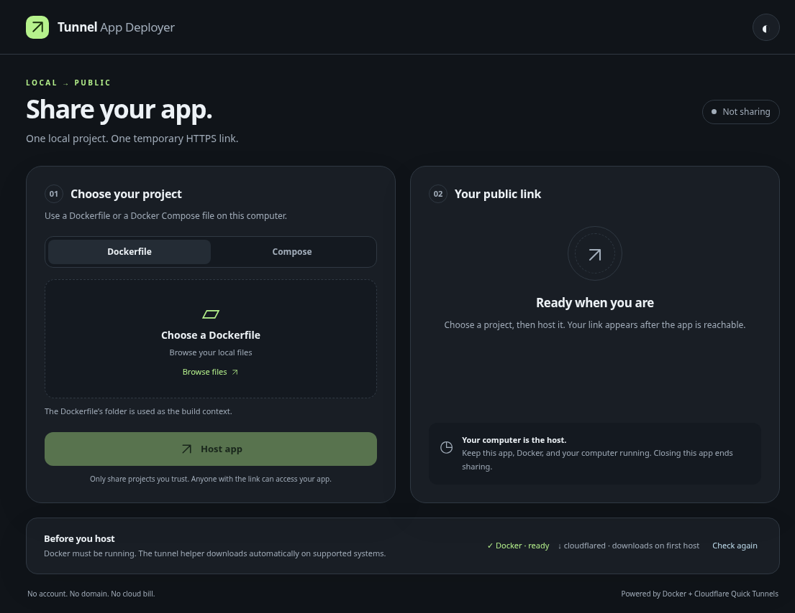

# Tunnel App Deployer

A local desktop application that turns a Dockerfile or Docker Compose project into a shareable Cloudflare Quick Tunnel link.

[Documentation and walkthrough](https://ding-ding-projects.github.io/tunnel-app-deployer/) · [Designer handoff](HANDOFF.md)

## Desktop preview

Captured from the actual desktop on Linux with real prerequisite checks and no active hosting session. This is not a public-tunnel success screenshot.

## Host in one click

Choose a local project, select its web entry point if needed, and press **Host**. The application builds and starts the containers, checks local health, starts a Quick Tunnel, and returns a verified HTTPS link. No AWS account, Cloudflare account, or custom domain is required.

The application runs on your computer. The link lasts only while your computer, containers and tunnel are running, and changes when a new tunnel is created. Anyone with the link can access the application; authentication inside your application remains intact. Quick Tunnels are intended for development and sharing, have no uptime guarantee, support up to 200 in-flight requests, and do not support server-sent events. See [Cloudflare's documentation](https://developers.cloudflare.com/tunnel/get-started/quick-tunnels/).

## Development status

The initial desktop and backend implementation is available. All 20 automated checks pass, covering lifecycle, cancellation, recovery, and desktop security. The actual Linux desktop launches, checks Docker and switches themes. Real Dockerfile and two-service Compose projects were built, started, and reached over local HTTP. Public tunnel verification is incomplete because the managed test environment refused the tunnel-service connection. No native Windows execution or end-to-end public hosting is claimed.

## Development

Requires Node.js 24 and a running Docker installation with Compose v2. The desktop manages its own tunnel process. Missing supported tunnel binaries are intended to be downloaded from a pinned official release and verified by SHA-256. The application must not install Docker silently, accept elevation prompts, or change unrelated containers.

Source responsibilities: `src/backend/` for hosting; `src/main.js` and `src/preload.js` for desktop integration; `src/renderer/` for the interface; `docs/` for the published documentation. Install dependencies with `npm ci`, run checks with `npm test`, and launch with `npm start`. `build.bat` or `npm run package:win` builds a Windows portable executable; Windows builds are also produced as CI artifacts on pushes to main. A packaged artifact is not evidence of native Windows runtime verification.

### Current data and recovery boundaries

Compose uses a fresh isolated project for each hosting attempt. Persistent volumes are retained when stopping, but previous volumes are not automatically reused on the next attempt. This preview is suitable for stateless demos; do not assume database continuity across sessions. External/shared resources and unsafe Compose options are rejected explicitly. Terminal failures clear the public URL and finish owned cleanup before another attempt. The application does not automatically fix arbitrary source-code or permission errors.
