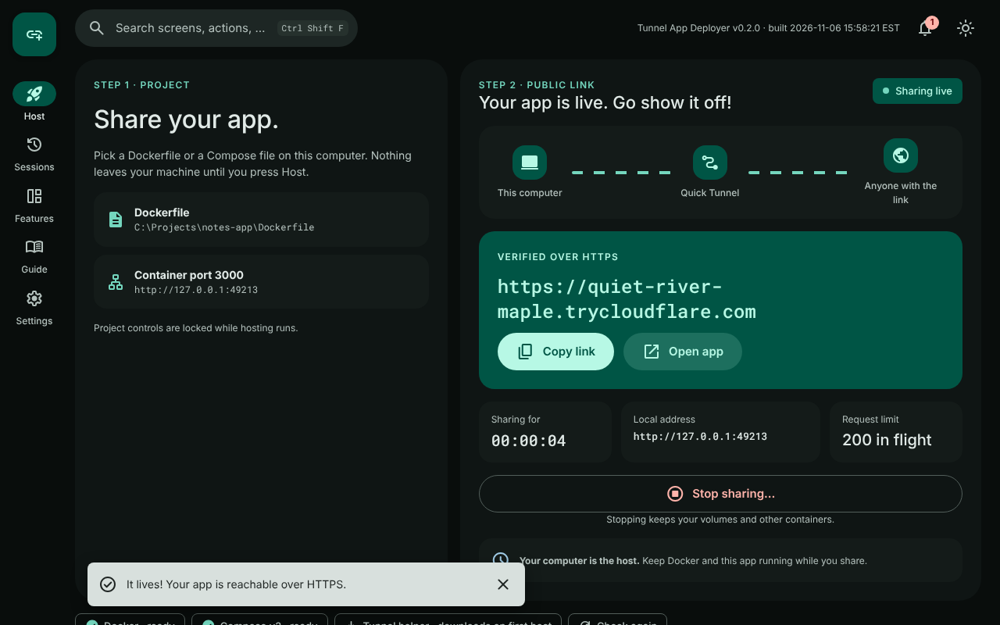

# Tunnel App Deployer

A local desktop application that turns a Dockerfile or Docker Compose project into a shareable, verified HTTPS link through a Cloudflare Quick Tunnel. Free, no account, no domain.

**[Website and guide](https://ding-ding-projects.github.io/tunnel-app-deployer/)** · [Releases](https://github.com/Ding-Ding-Projects/tunnel-app-deployer/releases) · [Roadmap](ROADMAP.md) · [Designer handoff](HANDOFF.md) · [Design files](design/)

<strong>What it does</strong>

Choose a local project, select its web service if needed, and press **Host**. The app builds and starts the containers, checks local health, opens a Quick Tunnel and only then shows the verified HTTPS link, with Copy and Open buttons. **Stop sharing** uses a two-key confirmation and cleans up everything the app created while keeping your volumes.

The app runs on your computer. The link lasts only while your computer, containers and tunnel are running, and changes with each session. Anyone with the link can open the application; authentication inside your application stays in place. Quick Tunnels are intended for development and sharing, have no uptime guarantee, support up to 200 in-flight requests and do not support server-sent events. See [Cloudflare's documentation](https://developers.cloudflare.com/tunnel/get-started/quick-tunnels/).

<strong>Features</strong>

- Material Design 3 interface with a navigation rail, a bottom bar for narrow windows and a live tunnel diagram
- Per-step progress with timings, and recovery buttons on the step that failed
- Sessions history with search, filters, statistics, bulk actions and JSON, CSV or Markdown export
- English, Hong Kong Cantonese and bilingual modes, with separate playfulness sliders
- Command palette on **Ctrl+Shift+F**, context menus with a filter field, and a regex builder beside every search
- Notification centre, settings history with restore, per-group reset and a changelog viewer
- Focus modes, motion levels with a reduced-motion path, action sounds, text size, density and accent colour
- An offline guide with every website article, and a first-run setup that checks Docker for real
- Version and build time on the first screen, read from the packaged build record

Every planned feature and its honest status is listed in [ROADMAP.md](ROADMAP.md), on the app's Features screen and on the website. All three come from `content/features.json`.

<strong>Download and run</strong>

Every push to `main` publishes the next tagged release with a Windows portable executable: see [Releases](https://github.com/Ding-Ding-Projects/tunnel-app-deployer/releases). Builds are unsigned. Docker Desktop (or Docker Engine with Compose v2) must be installed and running. The tunnel helper downloads automatically from a pinned official release and is checked by SHA-256.

<strong>Development</strong>

Requires Node.js 24 and a running Docker installation with Compose v2.

| Command | What it does |
| --- | --- |
| `npm ci` | Install dependencies |
| `npm test` | Run the test suite |
| `npm start` | Launch the desktop app |
| `npm run content` | Regenerate bundled content, `ROADMAP.md` and the website copies from `content/` |
| `npm run vendor` | Copy fonts from npm packages into the app and website |
| `python3 scripts/subset-site-icons.py` | Rebuild the website's icon font subset |
| `build.bat` or `npm run package:win` | Build the Windows portable executable |

Source layout: `src/backend/` hosting; `src/main.js` and `src/preload.js` desktop integration; `src/renderer/` interface; `content/` features, articles and changelog shared by the app and website; `docs/` the website; `design/` the design canvas.

<strong>Verification status</strong>

All 28 automated checks pass, covering hosting lifecycle, cancellation, recovery, desktop security, file saving, link allowlisting, build provenance, regex safety, translation completeness, Markdown escaping and generated-content freshness. The redesigned interface was rendered in headless Chrome from the real renderer code with a scripted backend for every state shown in `docs/assets/screens/`; those images are not captures of live hosting. Earlier smoke tests built and started real Dockerfile and Compose projects over local HTTP; public tunnel success and native Windows execution have not been verified in the managed environment.

<strong>Data and recovery boundaries</strong>

Compose uses a fresh isolated project for each hosting attempt. Persistent volumes are kept when stopping, but earlier volumes are not reused automatically. External or shared resources and unsafe Compose options are rejected explicitly. Terminal failures clear the public link and finish owned cleanup before another attempt. Session history, settings and notifications are stored only on this computer.

